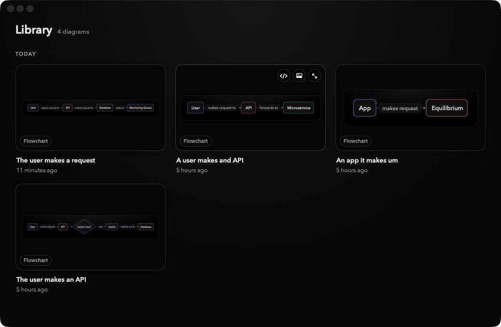
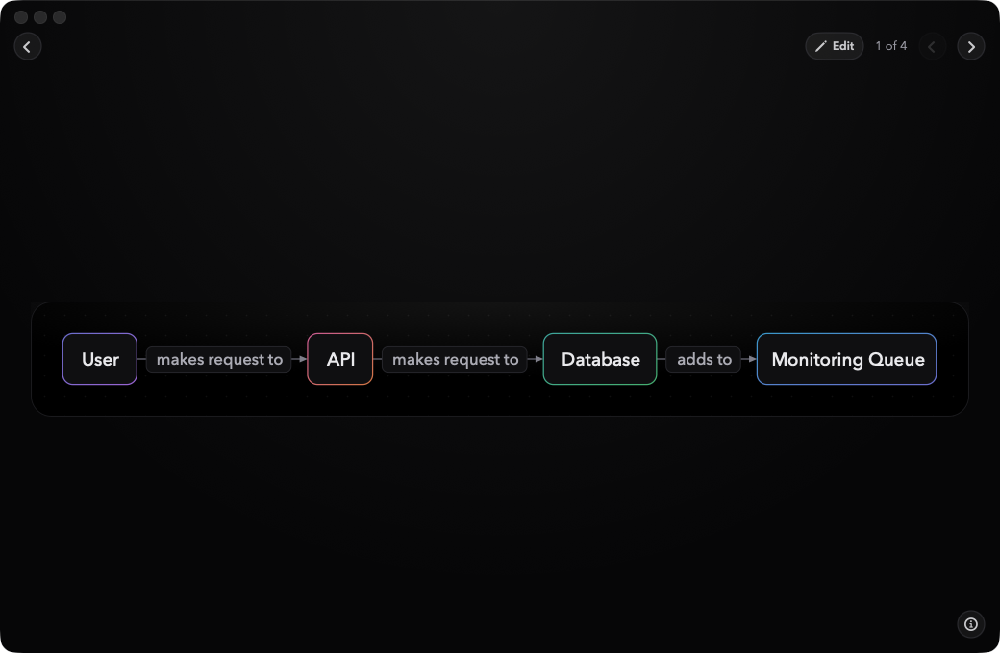

<p align="center"></p>

# termaid

A Mac menu-bar app that turns a plain-English description, typed or spoken, into a Mermaid
flowchart. Everything runs on-device: speech with Parakeet, diagrams with a small fine-tuned model.
Saved diagrams go to a Library window where you can browse, view and export them.

<p align="center">
  
  
</p>

The model never writes Mermaid. It returns compact JSON (`boxes` plus `[from, to, label]` edges),
and termaid validates it and generates the Mermaid itself, so the output is always syntactically
valid. Conditions become decision diamonds with yes/no branches. Every diagram is also checked
with [Pele](https://github.com/obsidianmd/pele).

> The model weights are not in this repo because of their size. Download `termaid.gguf` from
> [huggingface.co/VatsaIsHere/termaid](https://huggingface.co/VatsaIsHere/termaid) and pick it in
> the app's setup screen, or build your own with the training pipeline below.

## Layout

- `src/`: the shared engine in TypeScript: sentence splitting, prompts, reply cleanup, Mermaid
  output and rendering. It has no platform code, so a future Windows/Linux app can reuse it.
- `mac/`: the Swift package. It runs the model with llama.cpp, speech with Parakeet (FluidAudio),
  and the engine, bundled as `engine.js`, in JavaScriptCore.
- `scripts/`: development tools (end-to-end check, Ollama-vs-Swift comparison).
- `training/`: data generation, fine-tuning and evaluation.

## Mac engine

```sh
npm run build:engine            # build mac/Sources/TermaidCore/Resources/engine.js (not committed; rerun after changing src/)
cd mac && swift build -c release
.build/release/termaid-mac diagram ../training/gguf/lfm3-v10-q6_k.gguf "build, then test, then deploy"
.build/release/termaid-mac transcribe clip.wav     # 16 kHz mono WAV
.build/release/termaid-mac eval <model.gguf> <descriptions.txt>   # one JSON line per description
```

`scripts/verify-mac-engine.sh [model]` runs the tests, builds everything, transcribes a spoken
clip and generates a diagram from it.

Requires Node ≥ 23.6 (runs TypeScript directly) and Xcode 26 or newer.

## Fine-tuned model

termaid sends the description one sentence at a time, with the diagram so far, to LiquidAI/LFM3-1.7B
with a LoRA adapter trained on those per-sentence steps (`data-v10`, see below). It is released under the
[LFM Open License v1.0](https://huggingface.co/LiquidAI/LFM3-1.7B/blob/main/LICENSE), which does not
license commercial use by organizations with $10M+ annual revenue. Training, merging and GGUF
conversion run on Modal (Unsloth and MLX don't support LFM3):

```sh
cd training
python connected_stories.py 150 2 sonnet data-sonnet      # ~300 stories via the claude CLI, ~25 min
python build_data.py data-v9 data-v10 data-sonnet/stories.jsonl
TERMAID_DATA=data-v10 uvx modal run --detach modal_train_lfm3.py::main --name lfm3-v10 --steps 520
uvx modal run modal_train_lfm3.py::gguf --name lfm3-v10
mkdir -p gguf && uvx modal volume get termaid-runs lfm3-v10/lfm3-v10-f16.gguf gguf/
llama-quantize gguf/lfm3-v10-f16.gguf gguf/lfm3-v10-q6_k.gguf Q6_K
weight_space/run_eval.sh gguf/lfm3-v10-q6_k.gguf v10-q6k && node weight_space/score.ts v10-q6k base-q6k
ollama create termaid-lfm3 -f Modelfile-lfm3   # only for scripts/compare-engines.ts
```

`data-v9` comes from the template stories in `generate_data.py`, which mix software with hiring,
healthcare, logistics, finance and kitchen vocabularies (`training/domains.py`). `data-v10` drops
the v9 steps whose gold diagram breaks the app's own checks (`measure_problems.ts`, mostly boxes
nothing leads into) and adds ~300 long stories from `connected_stories.py`, where Claude writes
descriptions in which every sentence continues the flow. The steps were set for ~1.33 epochs.
`holdout-complex.txt` adds hand-written long descriptions, including domains never seen in
training (education, legal, manufacturing).

Check every checkpoint against `holdout.txt` (never in the training data). A learning rate of 1e-4
diverged. Use Q6_K, not Q4_K_M: on the 55 holdout descriptions, Q6_K produced the same diagram as
the unquantized model for 27 and Q4_K_M for only 17, for about 15% more speed.

Other training files:

- `holdout-front.txt`: hand-written "in front of" / "behind" routing cases, kept out of training like
  the other holdout files.
- `eval_termaid.ts`: runs holdout descriptions through the app's own per-sentence pipeline
  against an Ollama model: `node training/eval_termaid.ts <model> <descriptions.txt>`.

## Test

```sh
npm test
cd mac && swift test
```

## License

The code is MIT (see `LICENSE`). Fine-tuned model weights are covered by the
[LFM Open License v1.0](https://huggingface.co/LiquidAI/LFM3-1.7B/blob/main/LICENSE).
